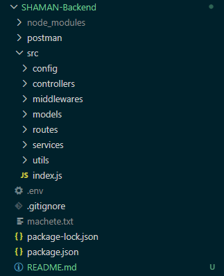

# SHAMANapp — API REST (Backend)

> *La magia de la organización.*

## ¿Qué es?

**SHAMANapp** es una API REST para organizar partidos de fútbol amateur entre amigos. Permite registrarse, armar equipos, crear partidos en una cancha (un "Lugar"), anotarse a partidos públicos y recibir notificaciones de todo lo que pasa (partidos confirmados, rechazados, cancelados, jugadores que se suman, etc.).

¿Cansado de no saber cuándo es el próximo partido con tus amigos? ¿Tenés ganas de jugar pero no tenés con quién? SHAMANapp junta en un solo lugar tus próximos encuentros y sus novedades:

- **Gestión simple:** creás tu usuario y listo. Podés anotarte a partidos, crear equipos con tus conocidos y sumar jugadores.
- **Administración sencilla:** para crear un partido elegís lugar, fecha y hora. Cuando el lugar lo confirma, te llega una notificación.
- **Búsqueda rápida:** si querés unirte a un partido público, lo buscás y te anotás.

### Motivo del proyecto

Es el proyecto final de la materia **Programación III**. La consigna es desarrollar una API REST con el stack MERN (este repositorio es el backend; el frontend SPA está en un repositorio aparte).

### Tipos de usuario

Hay una sola colección `Usuario` con tres tipos (todos inician sesión por el mismo endpoint):

| Tipo | Qué representa | Qué puede hacer |
|---|---|---|
| `jugador` | Una persona que juega | Crear equipos y partidos, unirse y bajarse de partidos, ver su historial |
| `lugar` | Una cancha o predio | Aprobar o rechazar los partidos que se crean en su cancha |
| `admin` | Administrador del sistema | Ver todos los usuarios y dar de baja usuarios, equipos, partidos y mensajes. **No cuenta como jugador** |

> Las bajas son siempre **lógicas**: nunca se borra un documento, se le cambia el `estado` a `eliminado`.

---

## ¿Desde dónde se puede usar?

La API está desplegada en **Render** (plan gratuito):

**https://shamanapp.onrender.com**

- Para probar que está viva: [`GET https://shamanapp.onrender.com/toyvivo`](https://shamanapp.onrender.com/toyvivo)
- Todos los endpoints cuelgan de `https://shamanapp.onrender.com/api/...`

> ⚠️ Al ser el plan gratuito, Render "duerme" el servicio tras un rato sin uso. La primera petición puede tardar **hasta un minuto** en responder; las siguientes son normales.

También se puede correr de forma local (ver más abajo), en `http://localhost:4000`.

---

## Tecnologías utilizadas

| Tecnología | Para qué se usa |
|---|---|
| **Node.js** | Entorno de ejecución de JavaScript del lado del servidor |
| **Express.js 5** | Framework para definir el servidor, las rutas y los middlewares |
| **MongoDB Atlas** | Base de datos NoSQL en la nube |
| **Mongoose** | Modelado de datos (Schemas, validaciones, discriminators) y conexión a MongoDB |
| **JSON Web Token (jsonwebtoken)** | Autenticación: el login devuelve un token que se manda en cada petición protegida |
| **bcryptjs** | Hasheo de contraseñas (nunca se guardan ni se devuelven en texto plano) |
| **dotenv** | Carga de variables de entorno desde el archivo `.env` |
| **cors** | Permite que el frontend (otro origen/puerto) consuma la API |
| **Postman** | Prueba de los endpoints |
| **Render** | Hosting del backend |
| **Git / GitHub** | Control de versiones |

El proyecto usa **ES Modules** (`"type": "module"`, sintaxis `import`/`export`).

---

## Software necesario

Antes de empezar, tené instalado:

| Software | Versión | Para qué |
|---|---|---|
| [Node.js](https://nodejs.org/) | **20.19.0 o superior** (recomendado: la última LTS) | Ejecutar el proyecto. Mongoose 9 no funciona con versiones anteriores |
| npm | Viene con Node.js | Instalar dependencias |
| [Git](https://git-scm.com/) | Cualquier versión reciente | Clonar el repositorio |
| [Postman](https://www.postman.com/downloads/) | Cualquier versión reciente | Probar los endpoints (opcional, pero recomendado) |
| Base de datos MongoDB | — | Una cuenta gratuita de [MongoDB Atlas](https://www.mongodb.com/atlas) (lo que usa el proyecto), **o** MongoDB Community Server instalado localmente |

Para verificar las versiones instaladas:

```bash
node -v
npm -v
git --version
```

---

## Variables de entorno

El proyecto lee su configuración de un archivo **`.env`** en la raíz del repositorio. Este archivo **no se sube a GitHub** (está en `.gitignore`), así que hay que crearlo a mano.

| Variable | Obligatoria | Descripción | Ejemplo |
|---|---|---|---|
| `MONGO_URI` | ✅ Sí | Cadena de conexión a MongoDB | `mongodb+srv://<usuario>:<contraseña>@<cluster>.mongodb.net/shaman` |
| `JWT_SECRET` | ✅ Sí | Clave secreta para firmar los tokens JWT. Cualquier texto largo y difícil de adivinar | `una_clave_larga_y_secreta_123` |
| `PORT` | No | Puerto del servidor. Si no se define, usa `4000` | `4000` |

Ejemplo de `.env`:

```env
MONGO_URI=mongodb+srv://<usuario>:<contraseña>@<cluster>.mongodb.net/shaman
JWT_SECRET=una_clave_larga_y_secreta_123
PORT=4000
```

> Si falta `MONGO_URI` o `JWT_SECRET`, el servidor no arranca y lo avisa por consola.
>
> Si usás **MongoDB Atlas**, acordate de autorizar tu IP en *Network Access* del cluster; si no, la conexión es rechazada. Si usás MongoDB local, la URI sería algo como `mongodb://localhost:27017/shaman`.

---

## Instalación y ejecución paso a paso

**1. Clonar el repositorio**

```bash
git clone https://github.com/WillIribarne/proyecto-sin-nombre-Backend.git
```

**2. Entrar a la carpeta del proyecto**

```bash
cd proyecto-sin-nombre-Backend
```

**3. Instalar las dependencias**

```bash
npm install
```

**4. Crear el archivo `.env`** en la raíz del proyecto, con las variables de la sección anterior.

**5. Ejecutar el proyecto**

Modo desarrollo (se reinicia solo cada vez que guardás un archivo, usando `node --watch`):

```bash
npm run devstart
```

Modo normal (el que se usa en producción):

```bash
npm start
```

**6. Verificar que funciona**

En la consola tendrían que aparecer estos mensajes:

```
[db] Conectado a MongoDB (shaman)
Servidor escuchando en el puerto 4000
```

Y al entrar a [http://localhost:4000/toyvivo](http://localhost:4000/toyvivo) desde el navegador o Postman, la respuesta es:

```json
{ "status": "gracias por darme vida" }
```

---

## Estructura y arquitectura del proyecto



El proyecto sigue una arquitectura en capas. Cada petición recorre este camino:

```
Petición HTTP → routes → middlewares → controllers → services → models → MongoDB
```

| Carpeta / archivo | Responsabilidad |
|---|---|
| `src/index.js` | Punto de entrada: crea el servidor Express, registra las rutas, el manejo de errores y conecta a la base de datos |
| `src/config/` | Conexión a MongoDB (`db.js`) y constantes compartidas: tipos de usuario, estados, tamaños de equipo (`constantes.js`) |
| `src/routes/` | Define las URLs de cada colección y qué middlewares y controller atienden cada una |
| `src/middlewares/` | Verificación del token JWT y de permisos (admin, lugar, capitán, creador, propio usuario) |
| `src/controllers/` | Reciben la petición, llaman al service y arman la respuesta HTTP |
| `src/services/` | Lógica de negocio y reglas de cada caso de uso |
| `src/models/` | Schemas de Mongoose: `Usuario` (con discriminators Jugador/Lugar/Admin), `Partido`, `Equipo` y `Mensajeria` |
| `src/utils/` | Funciones reutilizables: creación y respuesta de errores, controller y service genéricos |
| `postman/` | Colección de Postman con todos los endpoints |
| `.env` | Variables de entorno (no se sube al repositorio) |

Todos los errores se responden en JSON con el mismo formato:

```json
{ "error": "Descripción del error" }
```

---

## Colección de Postman

La colección con **todos los endpoints ya cargados** está en:

```
postman/SHAMAN-API.postman_collection.json
```

**Cómo usarla:**

1. En Postman: **Import** → seleccionar el archivo `.json`.
2. La colección trae estas variables (pestaña *Variables* de la colección):
   - `baseUrl`: por defecto `http://localhost:4000/api`. Para usar la API desplegada, cambiala por `https://shamanapp.onrender.com/api`.
   - `token`: pegá acá el token que devuelve el **Login**. Todas las peticiones protegidas lo usan automáticamente (Bearer Token heredado de la colección).
   - `idUsuario`, `idEquipo`, `idPartido`, `idMensaje`: pegá los `_id` que te devuelven las respuestas para no tener que escribirlos en cada URL.

---

## Endpoints

**Autenticación:** los endpoints marcados con 🔒 requieren estar logueado, enviando el token en el header:

```
Authorization: Bearer <token>
```

El token se obtiene con `POST /api/usuarios/login` y dura **24 horas**.

### 👤 Usuarios — `/api/usuarios`

| Método | Ruta | Qué hace | Requisitos previos |
|---|---|---|---|
| `POST` | `/registro` | Registra un usuario nuevo de tipo `jugador` o `lugar` | Ninguno |
| `POST` | `/login` | Inicia sesión con `mail` **o** `username` + `password`. Devuelve el token y los datos del usuario | Estar registrado |
| `GET` | `/` | Lista todos los usuarios activos | 🔒 Logueado como **admin** |
| `GET` | `/:id` | Muestra el perfil de un usuario. El `historial` solo lo ve el dueño del perfil o un admin | 🔒 Logueado |
| `PUT` | `/:id` | Modifica los datos del perfil (no permite cambiar `tipo`, `estado`, estadísticas, historial ni equipos) | 🔒 Logueado como **el mismo usuario** o **admin** |
| `DELETE` | `/:id` | Da de baja (lógica) a un usuario; ya no puede iniciar sesión | 🔒 Logueado como **admin** |

Body de ejemplo para registrar un jugador:

```json
{
  "tipo": "jugador",
  "username": "lionel",
  "password": "password123",
  "nombre": "Lionel",
  "apellido": "Messi",
  "mail": "lionel@test.com",
  "telefono": "1122334455"
}
```

Para registrar un lugar, se usa `"tipo": "lugar"` (sin `apellido`) y opcionalmente su `disponibilidad`:

```json
"disponibilidad": [{ "dia": "sabado", "hora": "18:00", "tipo_cancha": 5 }]
```

> El `password` debe tener al menos 8 caracteres y el `username` al menos 3. `username` y `mail` no se pueden repetir.
>
> Un **admin no puede registrarse** desde la API (por seguridad): se crea directamente en la base de datos.

### 👥 Equipos — `/api/equipos`

| Método | Ruta | Qué hace | Requisitos previos |
|---|---|---|---|
| `POST` | `/crear` | Crea un equipo con nombre, tamaño, integrantes y capitán | 🔒 Logueado |
| `GET` | `/` | Lista todos los equipos activos | Ninguno |
| `GET` | `/:id` | Muestra un equipo | Ninguno |
| `PUT` | `/:id` | Modifica el `nombre` y/o `jugadores_por_equipo` del equipo | 🔒 Logueado como **capitán** del equipo o **admin** |
| `DELETE` | `/:id` | Da de baja (lógica) el equipo | 🔒 Logueado como **capitán** o **admin** |
| `POST` | `/:id/agregar-jugador` | Suma un jugador al equipo (body: `{ "jugadorId": "..." }`) | 🔒 Logueado como **capitán** o **admin**; el equipo no puede estar completo |
| `DELETE` | `/:id/quitar-jugador/:jugadorId` | Quita un jugador del equipo (el capitán no se puede quitar) | 🔒 Logueado como **capitán** o **admin** |

Body de ejemplo para crear un equipo:

```json
{
  "nombre": "Los Pibes FC",
  "jugadores_por_equipo": 5,
  "integrantes": ["<id de jugador>"],
  "capitan": "<id de jugador>"
}
```

> `jugadores_por_equipo` puede ser **5, 7, 9 u 11**. El capitán tiene que estar entre los integrantes, y no puede haber más integrantes que `jugadores_por_equipo`.

### ⚽ Partidos — `/api/partidos`

| Método | Ruta | Qué hace | Requisitos previos |
|---|---|---|---|
| `POST` | `/crear` | Crea un partido en estado `pendiente_aprobacion` y le avisa al Lugar con un mensaje | 🔒 Logueado; tiene que existir el usuario **Lugar** |
| `GET` | `/` | Lista todos los partidos (excepto los eliminados) | Ninguno |
| `GET` | `/:id` | Muestra un partido | Ninguno |
| `PUT` | `/:id` | Modifica `fecha_horario`, `lugar`, `jugadores_por_equipo` y/o `accesibilidad` | 🔒 Logueado como **creador** del partido o **admin**; el partido debe estar `pendiente_aprobacion` o `confirmado` |
| `DELETE` | `/:id` | Da de baja (lógica) el partido y avisa a todos los jugadores anotados | 🔒 Logueado como **creador** o **admin** |
| `POST` | `/:id/aprobar` | El Lugar confirma el partido (`pendiente_aprobacion` → `confirmado`) y se le avisa al creador | 🔒 Logueado como **lugar**; el partido debe estar `pendiente_aprobacion` |
| `POST` | `/:id/rechazar` | El Lugar rechaza el partido (`pendiente_aprobacion` → `eliminado`) y se le avisa al creador | 🔒 Logueado como **lugar**; el partido debe estar `pendiente_aprobacion` |
| `POST` | `/:id/unirse` | Anota al usuario logueado en el equipo 1 o 2 (body: `{ "equipo": 1 }`) y se le avisa al creador | 🔒 Logueado; el partido debe estar **confirmado**, con lugar en ese equipo, y el usuario no debe estar ya anotado |
| `POST` | `/:id/bajarse` | Saca al usuario logueado del partido | 🔒 Logueado; estar anotado en el partido |

Body de ejemplo para crear un partido:

```json
{
  "fecha_horario": "2026-12-20T20:00:00.000Z",
  "lugar": "<id del usuario lugar>",
  "jugadores_por_equipo": 5,
  "accesibilidad": "publico"
}
```

> La `fecha_horario` tiene que ser una fecha **futura**. `accesibilidad` puede ser `publico` (por defecto) o `privado`.

**Ciclo de vida de un partido:**

```
pendiente_aprobacion ──(el Lugar aprueba)──▶ confirmado ──(se juega)──▶ finalizado
        │                                        │
        └──(el Lugar rechaza)──▶ eliminado       └──(se cancela)──▶ cancelado

Cualquier estado ──(baja lógica)──▶ eliminado
```

### ✉️ Mensajería — `/api/mensajes`

Los mensajes **no se crean a mano**: el sistema los genera automáticamente cuando pasa algo relevante (se crea un partido → aviso al Lugar; el Lugar aprueba o rechaza → aviso al creador; alguien se une → aviso al creador; se elimina un partido → aviso a los jugadores anotados).

| Método | Ruta | Qué hace | Requisitos previos |
|---|---|---|---|
| `GET` | `/` | Lista los mensajes recibidos por el usuario logueado (del más antiguo al más reciente) | 🔒 Logueado |
| `GET` | `/:id` | Muestra un mensaje | 🔒 Logueado como **el receptor** del mensaje |
| `PATCH` | `/:id/leer` | Marca el mensaje como leído | 🔒 Logueado como **el receptor** del mensaje |
| `DELETE` | `/:id` | Da de baja (lógica) un mensaje | 🔒 Logueado como **admin** |

---

## Flujo de prueba sugerido

Para probar el circuito completo con Postman:

1. **Registrar** un usuario `lugar` y uno o más usuarios `jugador`.
2. **Login** como jugador → copiar el token a la variable `token`.
3. **Crear partido** usando el `_id` del lugar.
4. **Login** como lugar → **Obtener mis mensajes** (aparece la solicitud) → **Aprobar partido**.
5. **Login** como jugador → **Unirse al partido** → **Obtener mis mensajes** (aparece la confirmación).
